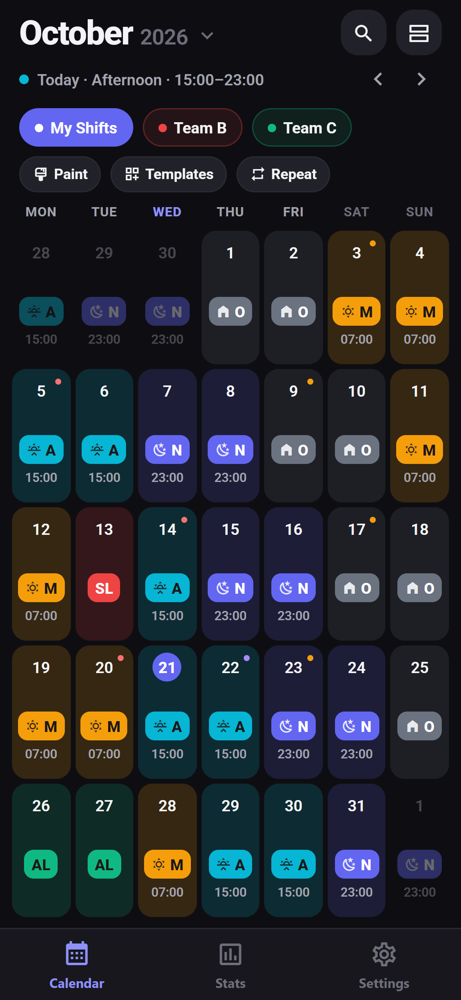
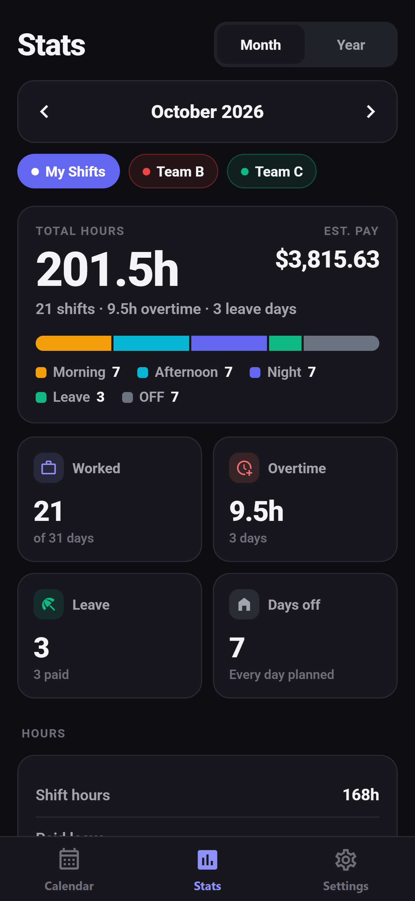
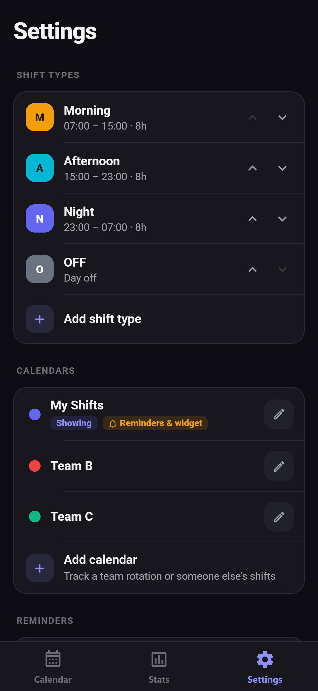
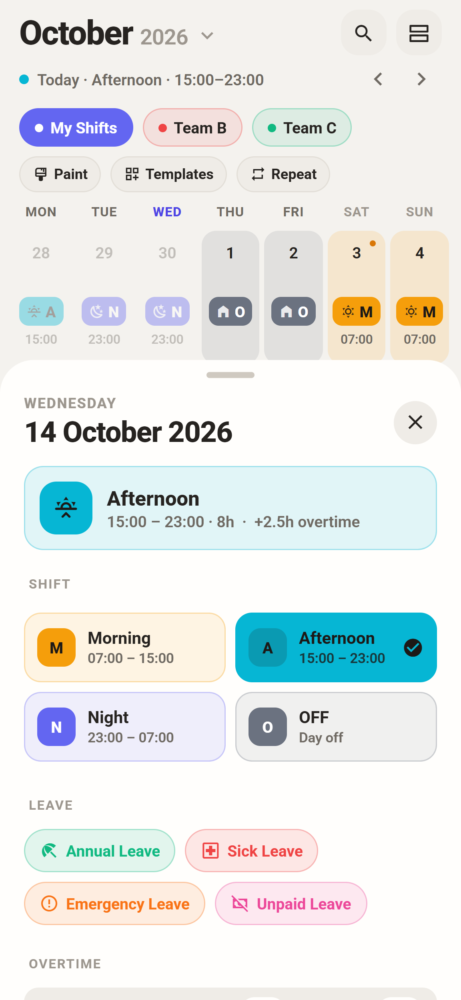
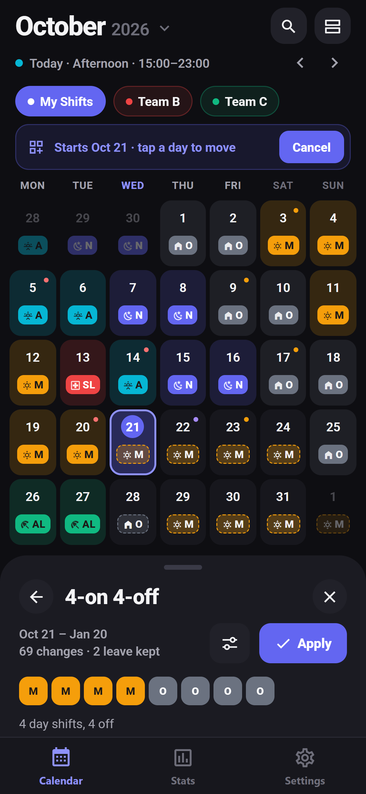
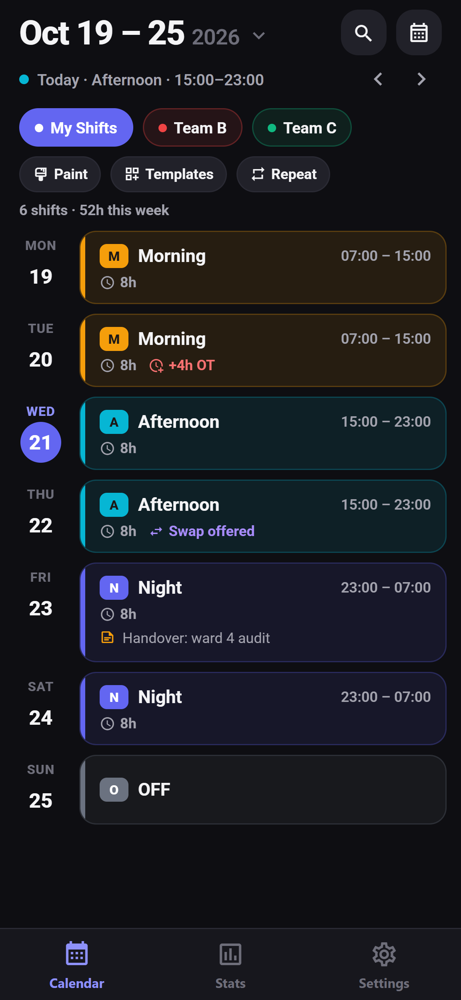

# ShiftCalendar

A modern, offline-first shift scheduling app for shift workers. Plan rotations, track leave, overtime and pay, and get reminded before every shift. Built with React Native + Expo.

[](https://github.com/iTroy0/ShiftCalendar/releases/latest)

## Screenshots

<p align="center">
  
  
  
</p>
<p align="center">
  
  
  
</p>

## Features

### Calendar
- **Month and week views** -- Swipeable month grid that adapts to phones, tablets and landscape (with a month summary beside the grid), plus a week agenda with times, hours, notes and swaps
- **Quick editing** -- Tap a day to open its sheet, long-press to drop in your last-used shift
- **Paint mode** -- Pick a shift or leave type as a brush and tap days to fill them, with undo
- **Rotation templates** -- 9 built-in rotations (2-2-2, 2-2-2-2, 4-on 4-off, 5-on 2-off, 3-on 3-off, 4-4-4, Continental, Panama 2-2-3, DuPont) with a live preview on the calendar before anything changes; leave days are kept
- **Repeat patterns** -- Select any run of days and repeat it forward for 1, 3, 6 or 12 months
- **Undo everywhere** -- Clearing a day, applying a template or repeating a pattern can be undone from the toast

### Shifts, leave and pay
- **Custom shifts** -- Your own names, codes, colors, icons and times, including overnight shifts; renaming a code updates every calendar
- **Leave tracking** -- Annual, Sick, Emergency and Unpaid leave with yearly balances; a day holds either a shift or leave, never both
- **Overtime and notes** -- Log overtime in half-hour steps and write notes that save as you type; search all notes from the header
- **Shift swaps** -- Offer a shift and share the request through any messaging app
- **Multiple calendars** -- Keep your own schedule next to team rotations and pick which one drives reminders and the widget
- **Stats** -- Monthly and yearly totals, a shift mix bar, monthly hours chart, per-shift hours, leave balances and a year at a glance
- **Pay estimate** -- Base and overtime rates, paid leave hours and 39 currencies

### Reminders, widget and data
- **Reminders and alarms** -- An evening reminder about tomorrow, an optional pre-shift alarm with its own sound, and a test notification to check sound and permissions
- **Android widget** -- This week's shifts on your home screen, following the app's light or dark theme
- **Export and import** -- Spreadsheet-friendly CSV, printable PDF month sheets, and full JSON backup and restore
- **Make it yours** -- Dark, light or system theme, 12/24-hour time, week starting Saturday, Sunday or Monday, optional haptics
- **Offline and private** -- Everything stays on your device. No account, no server, no tracking.
- **Accessible** -- Screen reader labels on interactive elements, and shifts are told apart by code and icon, not color alone

## Huawei Watch GT companion

<p align="center">
  
</p>

[`watch/`](watch) has a small read-only app for Huawei GT-series watches (written for the GT 7). It shows a month calendar styled like the watch's own Calendar app, with your shifts in their colours, worked out from the rotation you set in its config. You build and install it yourself with DevEco Studio; see [watch/README.md](watch/README.md).

## Getting Started

### Prerequisites

- [Node.js](https://nodejs.org/) 20.19 or newer
- [Expo CLI](https://docs.expo.dev/get-started/installation/)

### Installation

```bash
git clone https://github.com/iTroy0/ShiftCalendar.git
cd ShiftCalendar
npm install
```

### Development

```bash
npx expo start
npx expo start --android
npx expo start --ios
```

> **Note:** The Android home screen widget and the custom alarm sound need an EAS development build, not Expo Go.

## Building

### Cloud Build (EAS)

```bash
npm install -g eas-cli
eas login

# Preview APK
eas build --platform android --profile preview

# Production AAB (for Google Play)
eas build --platform android --profile production
```

### Local Build

```bash
npx expo prebuild --platform android
cd android
./gradlew assembleRelease
```

## Project Structure

```
ShiftCalendar/
├── app/
│   ├── _layout.tsx               # Providers, splash, onboarding gate
│   └── (tabs)/
│       ├── index.tsx             # Calendar screen
│       ├── stats.tsx             # Stats screen
│       └── settings.tsx          # Settings screen
├── components/
│   ├── calendar/                 # Pager, month grid, day cells, week agenda, header, paint palette
│   ├── stats/                    # Distribution bar, monthly hours chart, leave meters
│   ├── settings/                 # Settings sections, calendar and currency editors
│   ├── ui/                       # Shared primitives (Tap, Card, Button, Chip, sheet chrome)
│   ├── DaySheet.tsx              # Day details: shift, leave, overtime, note, swap
│   ├── TemplateSheet.tsx         # Rotation templates with preview
│   ├── RepeatSheet.tsx           # Repeat a pattern of days
│   ├── NotesSearchSheet.tsx      # Search all notes
│   ├── ShiftEditor.tsx           # Create and edit shift types
│   ├── Onboarding.tsx            # First-run setup
│   └── YearlyOverview.tsx        # Year at a glance
├── hooks/
│   ├── useShiftData.ts           # Calendars, shifts, leave, notes; AsyncStorage persistence
│   ├── useSettings.ts            # Preferences (theme, week start, pay, reminders)
│   ├── ShiftContext.tsx          # Shift data context
│   ├── SettingsContext.tsx       # Settings context
│   ├── useBackgroundSync.ts      # Keeps notifications and the widget up to date
│   └── useDeepLinkHandler.ts     # Opening CSV and backup files
├── constants/                    # Shift types, templates, leave types, currencies, colors, theme tokens
├── utils/
│   ├── dates.ts / time.ts        # DST-safe date keys, month grids, time formatting
│   ├── patterns.ts               # Template and repeat fills
│   ├── statsCalculation.ts       # Hours, pay and leave totals
│   ├── notificationPlan.ts       # Which reminders and alarms to schedule
│   ├── notifications.ts          # Scheduling with expo-notifications
│   ├── csv.ts / csvFormat.ts     # CSV parsing and the export/import format
│   └── exportImport.ts           # CSV, PDF and backup files
├── widgets/                      # Android widget UI, data model and task handler
├── watch/                        # Huawei Watch GT companion app (lite wearable, built with DevEco Studio)
└── assets/                       # App icons, splash and alarm sound
```

## Tech Stack

- **Framework** -- React Native + Expo SDK 55
- **Language** -- TypeScript
- **Routing** -- Expo Router (file-based)
- **Animations and gestures** -- react-native-reanimated, react-native-gesture-handler
- **Bottom sheets** -- @gorhom/bottom-sheet
- **Storage** -- @react-native-async-storage/async-storage
- **Notifications** -- expo-notifications
- **Files** -- expo-file-system, expo-document-picker, expo-sharing, expo-print
- **Widget** -- react-native-android-widget
- **Date math** -- date-fns
- **Haptics** -- expo-haptics

## License

MIT

## Author

Made by **Troy**
