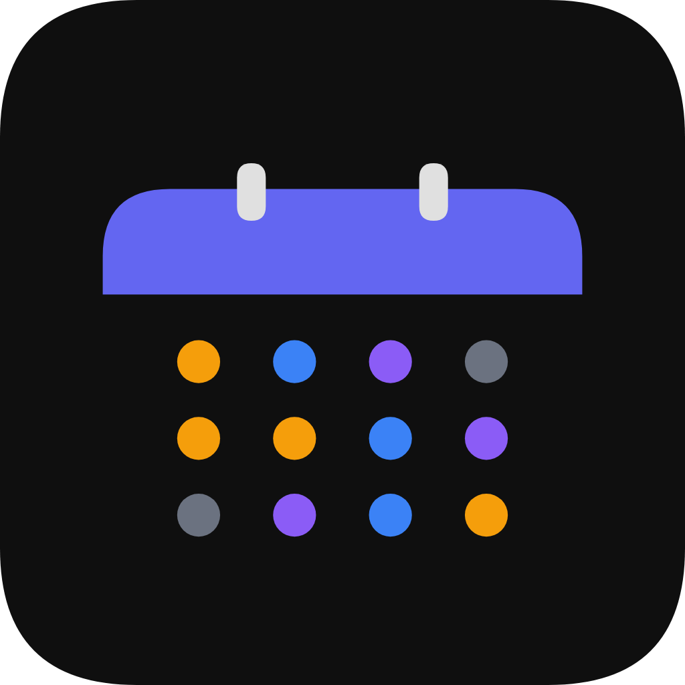

<p align="center">
  
</p>

<h1 align="center">ShiftCalendar</h1>

<p align="center">
  <b>A shift calendar for people whose days off keep moving.</b>
</p>

<p align="center">
  Pick your rotation once and it fills in the months ahead: every shift, day off and leave day, with a reminder the evening before. Free and open source. No ads, no account, and it works offline.
</p>

<p align="center">
  <a href="https://github.com/iTroy0/ShiftCalendar/releases/latest"></a>
  <a href="https://buymeacoffee.com/iTroy0"></a>
</p>

<p align="center">
  
  
  
</p>
<p align="center">
  
  
  
</p>

## Made for rotating shifts

For anyone whose schedule doesn't follow the week: nurses, paramedics, police, firefighters, security guards, and crews in factories, plants and oil fields. Start from one of the nine built-in rotations, or paint your own pattern and repeat it for up to a year.

| Rotation | Pattern |
| --- | --- |
| 2-2-2 | 2 days, 2 nights, 2 off |
| 2-2-2-2 | 2 mornings, 2 afternoons, 2 nights, 2 off |
| 4-on 4-off | 4 day shifts, 4 off |
| 5-on 2-off | 5 day shifts, 2 off |
| 3-on 3-off | 3 day shifts, 3 off |
| 4-4-4 | 4 days, 4 nights, 4 off |
| Continental | 2 days, 2 nights, 2 off, 3 days, 2 nights, 3 off |
| Panama 2-2-3 | 2 on, 2 off, 3 on, 2 off, 2 on, 3 off |
| DuPont | 4 nights, 3 off, 3 days, 1 off, 3 nights, 3 off, 4 days, 7 off |

## Features

### Calendar
- **Month and week views**: a swipeable month grid for phones, tablets and landscape, and a week agenda with times, hours, notes and swaps.
- **Quick editing**: tap a day to open it, or long-press to drop in the shift you used last.
- **Paint mode**: pick a shift or leave type as a brush and tap days to fill them.
- **Rotation preview**: see a rotation on your calendar before you apply it. Leave you've booked is kept.
- **Repeat patterns**: select a run of days and repeat it for 1, 3, 6 or 12 months.
- **Undo**: clearing a day, applying a rotation and repeating a pattern can all be undone.

### Shifts, leave and pay
- **Your own shifts**: names, codes, colours, icons and times, overnight shifts included.
- **Leave**: Annual, Sick, Emergency and Unpaid leave, with yearly balances.
- **Overtime and notes**: log overtime in half-hour steps, write notes on any day and search them all.
- **Shift swaps**: offer a shift and send the request through any messaging app.
- **Several calendars**: keep your own schedule next to your team's rotations, and choose which one drives reminders and the widget.
- **Stats**: monthly and yearly hours, your shift mix, leave balances and the whole year at a glance.
- **Pay estimate**: base and overtime rates and paid leave hours, in 39 currencies.

### Reminders, widget and backups
- **Reminders and alarms**: a reminder the evening before, and an optional alarm before each shift with its own sound.
- **Home screen widget**: this week's shifts, in light or dark.
- **Export and backup**: CSV for spreadsheets, printable PDF month sheets, and a full backup you can restore on a new phone.
- **Your way**: dark, light or system theme, 12- or 24-hour time, and weeks that start on Saturday, Sunday or Monday.
- **Private**: everything stays on your phone. No account, no server, no ads, no tracking. Read the [privacy policy](https://itroy0.github.io/ShiftCalendar-privacy/).
- **Accessible**: screen reader labels on buttons and controls, and shifts are told apart by code and icon, not only by colour.

## Install

ShiftCalendar runs on Android 7.0 or newer.

1. On your phone, open the [latest release](https://github.com/iTroy0/ShiftCalendar/releases/latest) and download the `.apk` file.
2. Open the file. If Android asks, let your browser or file manager install apps.
3. Follow the first-run setup. You can pick a rotation there or later.

New versions install over the old one and keep your shifts, notes and settings. To hear about updates, watch this repo's releases, or add `https://github.com/iTroy0/ShiftCalendar` to [Obtainium](https://github.com/ImranR98/Obtainium). What changed in each version is in the [changelog](CHANGELOG.md).

## Huawei Watch GT companion

<p align="center">
  
</p>

[`watch/`](watch) has a small app for Huawei GT-series watches (written for the GT 7). It shows a month calendar styled like the watch's own Calendar app, with your shifts in their colours, worked out from the rotation you pick on the watch the first time it opens. Hold a date to book annual leave. You build and install it yourself with DevEco Studio; see [watch/README.md](watch/README.md).

## Support

ShiftCalendar is free and will stay free, with no ads. If it makes your roster easier to live with, you can help:

- **Star the repo** so other shift workers can find it.
- **Share it** with the people you work with.
- **Report bugs and ask for features** in [Issues](https://github.com/iTroy0/ShiftCalendar/issues).
- **Buy me a coffee** if you'd like to chip in.

<a href="https://buymeacoffee.com/iTroy0"></a>

## Build it yourself

You need [Node.js](https://nodejs.org/) 20.19 or newer.

```bash
git clone https://github.com/iTroy0/ShiftCalendar.git
cd ShiftCalendar
npm install
npx expo start
```

The home screen widget and the custom alarm sound need an EAS development build, not Expo Go.

To build in the cloud with EAS:

```bash
npm install -g eas-cli
eas login
eas build --platform android --profile preview      # APK
eas build --platform android --profile production   # AAB for Google Play
```

Or locally:

```bash
npx expo prebuild --platform android
cd android
./gradlew assembleRelease
```

Release APKs come from the [Android release build](.github/workflows/android-release.yml) workflow, which attaches the APK to a draft release for the version in `app.json`.

<details>
<summary>Project structure</summary>

```
ShiftCalendar/
├── app/
│   ├── _layout.tsx               # Providers, splash, onboarding gate
│   └── (tabs)/
│       ├── index.tsx             # Calendar screen
│       ├── stats.tsx             # Stats screen
│       └── settings.tsx          # Settings screen
├── components/
│   ├── calendar/                 # Pager, month grid, day cells, week agenda, header, paint palette
│   ├── stats/                    # Distribution bar, monthly hours chart, leave meters
│   ├── settings/                 # Settings sections, calendar and currency editors
│   ├── ui/                       # Shared primitives (Tap, Card, Button, Chip, sheet chrome)
│   ├── DaySheet.tsx              # Day details: shift, leave, overtime, note, swap
│   ├── TemplateSheet.tsx         # Rotation templates with preview
│   ├── RepeatSheet.tsx           # Repeat a pattern of days
│   ├── NotesSearchSheet.tsx      # Search all notes
│   ├── ShiftEditor.tsx           # Create and edit shift types
│   ├── Onboarding.tsx            # First-run setup
│   └── YearlyOverview.tsx        # Year at a glance
├── hooks/
│   ├── useShiftData.ts           # Calendars, shifts, leave, notes; AsyncStorage persistence
│   ├── useSettings.ts            # Preferences (theme, week start, pay, reminders)
│   ├── ShiftContext.tsx          # Shift data context
│   ├── SettingsContext.tsx       # Settings context
│   ├── useBackgroundSync.ts      # Keeps notifications and the widget up to date
│   └── useDeepLinkHandler.ts     # Opening CSV and backup files
├── constants/                    # Shift types, templates, leave types, currencies, colors, theme tokens
├── utils/
│   ├── dates.ts / time.ts        # DST-safe date keys, month grids, time formatting
│   ├── patterns.ts               # Template and repeat fills
│   ├── statsCalculation.ts       # Hours, pay and leave totals
│   ├── notificationPlan.ts       # Which reminders and alarms to schedule
│   ├── notifications.ts          # Scheduling with expo-notifications
│   ├── csv.ts / csvFormat.ts     # CSV parsing and the export/import format
│   └── exportImport.ts           # CSV, PDF and backup files
├── widgets/                      # Android widget UI, data model and task handler
├── watch/                        # Huawei Watch GT companion app (lite wearable, built with DevEco Studio)
└── assets/                       # App icons, splash and alarm sound
```

</details>

<details>
<summary>Tech stack</summary>

- **Framework**: React Native + Expo SDK 55
- **Language**: TypeScript
- **Routing**: Expo Router (file-based)
- **Animations and gestures**: react-native-reanimated, react-native-gesture-handler
- **Bottom sheets**: @gorhom/bottom-sheet
- **Storage**: @react-native-async-storage/async-storage
- **Notifications**: expo-notifications
- **Files**: expo-file-system, expo-document-picker, expo-sharing, expo-print
- **Widget**: react-native-android-widget
- **Date math**: date-fns
- **Haptics**: expo-haptics

</details>

## License

[MIT](LICENSE). Made by [Troy](https://github.com/iTroy0).
