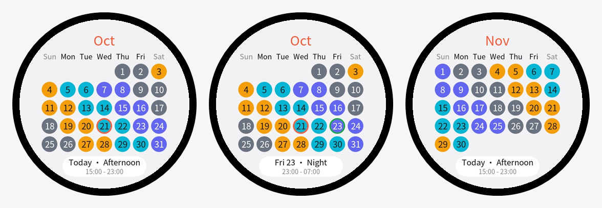

# ShiftCalendar for Huawei Watch GT

A read-only shift calendar for Huawei's GT-series watches. It's written for the Watch GT 7 (466 × 466 round screen) using Huawei's "lite wearable" JavaScript framework. It shows one month at a time, styled like the watch's own Calendar app, with each working day in its shift's colour. Shifts are worked out on the watch from your rotation, so it needs no phone connection.

<p align="center">
  
</p>

> Screens above come from the lite wearable Simulator in Huawei's SDK. The watch's own font looks slightly different.

## What it does

- **Shift colours**: every day of your rotation is a circle in its shift's colour: amber Morning, cyan Afternoon, indigo Night and grey for days off.
- **Today** is marked in orange.
- **Change month**: swipe up for the next month and down for the previous one, or turn the crown.
- **Check a day**: tap a date to see its shift and hours in the pill at the bottom. The date you tapped gets a green ring. The pill shows today's shift when the app opens.

There's nothing to edit on the watch. Your rotation is set once in `config.js` before you build. It doesn't sync with the phone app, so leave, swaps, overtime and one-off changes don't appear.

## Set your rotation

Open [`entry/src/main/js/default/common/config.js`](entry/src/main/js/default/common/config.js) and set two values:

```js
export const MY_ROTATION = '2-2-2-2';       // one of the names in ROTATIONS
export const ROTATION_START = '2026-10-19'; // the date of any day 1 of that rotation
```

Day 1 is the first entry in the rotation's `days` list. For 2-2-2-2 (`M M A A N N O O`), that's the first of your two Morning days. Any past or future cycle works.

You can also change these in `config.js`:

- **Shifts**: names, times and colours. The defaults match the phone app.
- **Rotations**: the phone app's templates. Add your own as a list of shift codes, any length.
- **Leave**: add your booked days to `LEAVE`, as one day (`{ from: '2026-12-24', type: 'AL' }`) or a range with `to`. Types are `AL`, `SL`, `EL` and `UL`, shown in the phone app's leave colours.
- **First day of the week**: `WEEK_START`. It defaults to Sunday, like the watch's calendar.

If the rotation name or date is wrong, the watch shows a plain calendar with **Check config.js** in the pill.

## What you need

- A Windows or Mac computer with [DevEco Studio](https://developer.huawei.com/consumer/en/deveco-studio/) 5.0.5 or newer. It was last built with DevEco Studio 6.1.
- A Huawei developer account with identity verification done, used to sign the app for your own watch.
- Your Android phone with **Huawei Health** (watch paired) and **HUAWEI DevEco Assistant**, both from AppGallery.

## Project layout

This folder is a complete DevEco Studio project (lite wearable, FA model, JS):

```
entry/src/main/config.json                bundle name, device type, pages
entry/src/main/js/default/
  app.js
  common/config.js                         your shifts and rotation (edit this)
  common/colors.js                         the light theme's colours
  common/schedule.js                       rotation maths and the month grid
  pages/index/                             the month calendar
entry/src/main/resources/base/             app name and icon
```

The bundle name is `com.itroy0.shiftcalendar.watch`, set in `entry/src/main/config.json`. Use the same name in AppGallery Connect, or change both.

## 1. Open it and check the Previewer

In DevEco Studio, choose **File → Open** and pick this `watch` folder. Wait for the sync to finish, then open `entry/src/main/js/default/pages/index/index.hml` and start the **Previewer**. It shows the page on a round 466 × 466 lite wearable. The Previewer needs no signing.

## 2. Sign it

These steps come from Huawei's lite wearable guides and community write-ups for earlier GT watches. I couldn't try them on a GT 7, and menu names move between DevEco versions, so treat Huawei's docs for your watch as the final word.

1. **Find your watch's UDID.** In DevEco Assistant, open the **Lite Wearable** tab and tap **Connect**. Huawei Health opens; pair the watch there. DevEco Assistant then shows the watch's UDID.
2. **Register the watch** in [AppGallery Connect](https://developer.huawei.com/consumer/en/service/josp/agc/index.html): **Users and permissions → Device management → Add device**, with that UDID.
3. **Make a debug certificate.** In DevEco Studio use **Build → Generate Key and CSR**. Upload the CSR in AppGallery Connect under **Users and permissions → Certificate management → New certificate**, then download the `.cer` file.
4. **Make a debug profile.** Create a HarmonyOS app in AppGallery Connect with the bundle name above. Under its **HAP Provision Profile → Add**, choose **Debug**, include your watch, and download the `.p7b` file.
5. **Add them to the project.** In **File → Project Structure → Signing Configs**, use your `.p12` key store, `.cer` and `.p7b`.

DevEco Studio saves the signing config in `build-profile.json5` with paths on your computer. Don't commit that change.

## 3. Build and install

Build with **Build → Build Hap(s)/APP(s) → Build Hap(s)**, or from a terminal in this folder:

```powershell
$env:DEVECO_SDK_HOME = 'C:\Program Files\Huawei\DevEco Studio\sdk'
& 'C:\Program Files\Huawei\DevEco Studio\tools\hvigor\bin\hvigorw.bat' assembleHap --mode module -p product=default -p buildMode=debug --no-daemon
```

The `.hap` ends up in `entry/build/default/outputs/default/`. It's `entry-default-unsigned.hap` until signing is set up, then `entry-default-signed.hap`. Copy the signed `.hap` to your phone and install it on the watch from DevEco Assistant.

To change your rotation later, edit `config.js`, rebuild and reinstall.

## Notes for development

The lite wearable framework is much smaller than a browser:

- Every element needs an explicit width and height.
- Only a subset of CSS is supported, and `{{ }}` bindings must be plain values. The build turns the JS into ES5, but keep to simple syntax: no spread, for example.
- The JavaScript engine has no `RegExp`. A regex literal anywhere in a page's code stops the page loading, and the Previewer stays black.
- Don't name a page method `render`: the framework stores the compiled template under that name.
- Each page must stay under 48 KB once compiled.
- GT watches refuse an app (`Installation failed: 40`) unless it has a small icon too: keep `icon_small.png` next to `icon.png` in `resources/base/media`. The JS also has to sit in `js/default`.
- Keep the page cheap to update: the month grid is built once and only its values change.
- Install from the Lite version of DevEco Assistant that Huawei links on its developer forum.
- If the Previewer stays black, look for `[JS Error]` lines in DevEco Studio's `previewer.log` (**Help → Show Log in Explorer**).
- The crown reaches JS apps only through a single-column `<picker-view>` that calls `rotation({ focus: true })`. That's why the month title is a one-row picker. If your watch doesn't pass the crown to it, swiping still changes the month.

Huawei's [lite wearable samples](https://gitcode.com/HarmonyOS_Samples/BestPracticeSnippets/tree/master/LiteWearable) and the [ArkUI JS lite reference](https://gitcode.com/openharmony/docs/blob/OpenHarmony-4.0-Release/en/application-dev/reference/arkui-js-lite/Readme-EN.md) cover the details.
